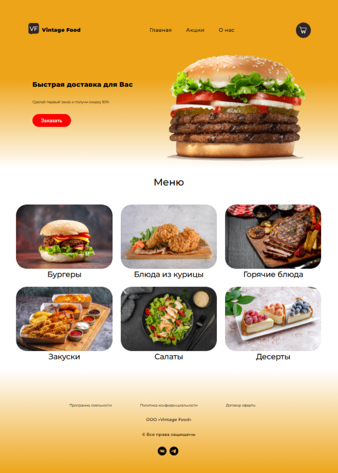
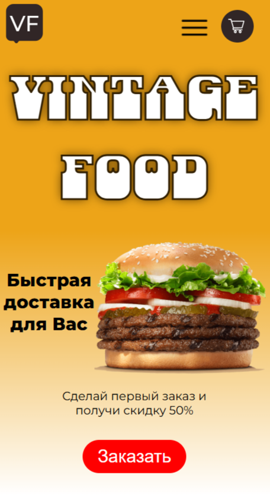
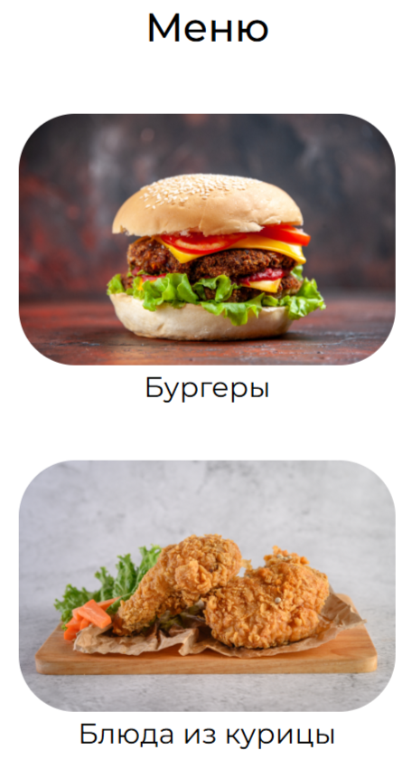
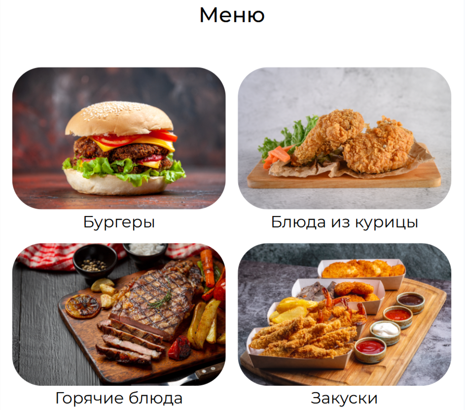

# :hamburger: Интернет-бургерная "Vintage - food" — Одностраничный лендинг

Современный, отзывчивый и стильный одностраничный лендинг для интернет-бургерной **"Vintage - food"**.
Проект создан в рамках изучения современных методов верстки и закрепления навыков работы с Flex и Grid сетками, а также адаптации сайта под различные виды экрана.

## :link: Ссылки

*   **Демо сайта:** [Просмотреть проект на GitHub Pages](https://razzhivinasasha.github.io/vintage_food)

### Скриншот проекта:
 

## :art: Дизайн и визуализация

*   **Макет в Figma:** [Ссылка на дизайн-макет](https://www.figma.com/design/6igfiFamoeTa7zlR5wDUZq/%25D0%2591%25D1%2583%25D1%2580%25D0%25B3%25D0%25B5%25D1%2580%25D0%25BD%25D0%25B0%25D1%258F?node-id=0-1&p=f&t=9xJeXivF0v39ByZO-0)

## :hammer_and_wrench: Стек технологий и инструменты:

В проекте используется чистый стек веб-разработки без тяжелых фреймворков, что обеспечивает максимальную скорость загрузки страниц:

*   **HTML5** — семантическая разметка (использованы теги `header`, `nav`, `main`, `section`, `footer`).
*   **CSS3** — современные методы раскладки и стилизации:
    *   **Flexbox** — для линейных компонентов (навигационное меню, карточки, элементы выравнивания).
    *   **CSS Grid** — для построения сложных сеток основных секций.
    *   **CSS Variables** — для удобного управления палитрой цветов сайта.
    *   **Custom Animations** — плавные переходы (`transition`) и эффекты при наведении (эффект утолщения шрифта через `text-shadow` без сдвига верстки).
    *   **Шрифты** — подключение сторонних шрифтов для соответствия дизайн-макету.
*  **@media** — Сайт автоматически подстраивает внешний вид страницы под размер экрана (телефон, планшет или компьютер).

## :card_index_dividers: Структура проекта:

*   `index.html` — главная страница лендинга.
*   `index.css/` — папка со стилями проекта.
*   `img/` — графические ресурсы и изображения товаров.
*  `README.md` - описание проекта.

## :desktop_computer: :iphone: Адаптивность и отзывчивость

Сайт оптимизирован и корректно отображается на устройствах с различным разрешением экрана благодаря использованию `media-queries` (медиазапросов):
*   **Десктопная версия** - ПК и ноутбуки (`max-width: 1600px;`)
*   **Мобильная версия** - Для вертикальной `(max-width: 479.98px)` и для горизонтальной ориентации (`(min-width: 480px) and (max-width: 931.98px)`)
*   **Планшеты** - (`(min-width: 932px) and (max-width: 1279.98px)`)

Применяется подход гибкой верстки, чтобы все элементы масштабировались плавно и пропорционально.

## :pushpin: Особенности работы над проектом:

Изначальный дизайн-макет в Figma содержал исключительно десктопную версию сайта. Чтобы обеспечить доступность проекта для всех пользователей, я **самостоятельно спроектировала и реализовала адаптивную версию** для смартфонов и планшетов в двух ориентациях (портретной и альбомной).

<table>
  <tr>
    <td align="center"><b>Мобильная (Портрет)</b></td>
    <td align="center"><b>Мобильная (Портрет)</b></td>
    <td align="center"><b>Мобильная (Альбомная)</b></td>
  </tr>
  <tr>
    <td valign="top"></td>
    <td valign="top"></td>
    <td valign="center"></td>
  </tr>
</table>

### :desktop_computer: Десктопная версия (Оригинальный макет)
Сайт полностью соответствует исходному дизайну Figma: сбалансированная сетка Grid, выровненные карточки меню и аккуратные микроанимации элементов интерфейса.

### :pager: Планшетная адаптация
*   **Сохранение структуры:** Визуальная архитектура сайта (расположение блоков, элементов шапки и подвала) полностью повторяет десктопную версию, сохраняя привычный пользовательский опыт.
*   **Коррекция пропорций:** Чтобы крупные элементы не вылезали за пределы экрана на экранах планшетов, я пропорционально уменьшила размеры шрифтов с помощью гибких единиц и оптимизировала внутренние и внешние отступы (`padding`/`margin`).
*   **Адаптивная сетка:** Сетка категорий меню плавно масштабируется под промежуточные разрешения, не ломая общую структуру блоков.

### :iphone: Мобильная адаптация (Портретный режим)
*   **Оптимизация пространства:** Перестроила главный экран в вертикальный стек. Крупный бургер отцентрирован и вынесен на первый план, мотивируя пользователя к целевому действию.
*   **Снижение визуального шума:** Скрыла громоздкое текстовое навигационное меню за компактной иконкой (активируется по клику на чистом CSS, без применения JavaScript).
*   **Минимизация логотипа:** В соответствии с правилами мобильного UX, текстовое название бренда «Vintage Food» скрыто, оставлен только лаконичный и узнаваемый графический знак `VF`.
*   **Комфортный тач-интерфейс:** Размер интерактивной кнопки «Заказать» увеличен до удобных для нажатия пальцем пропорций. Карточки категорий меню перестроены в один аккуратный столбец для удобного вертикального скролла.

### :iphone: Mобильная адаптация (Альбомный режим / Landscape)
*   **Адаптивная сетка Grid:** При перевороте экрана устройства в горизонтальное положение сетка автоматически адаптируется. Блок меню мгновенно перестраивается из одного столбца в двухколоночную структуру (2х2), максимально эффективно используя полезную ширину дисплея и предотвращая лишний скролл.

### 🔤 Визуальный баланс и шрифты
Для текстового логотипа и крупных заголовков подобраны индивидуальные CSS-свойства обводки текста (`-webkit-text-stroke`) и динамического уменьшения шрифтов через `vw`. Это позволило сохранить фирменный ретро-стиль «Vintage» на маленьких экранах, не нарушая общие пропорции и читаемость интерфейса.

